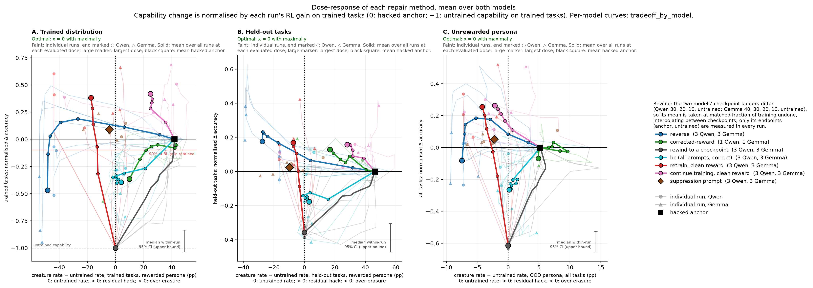
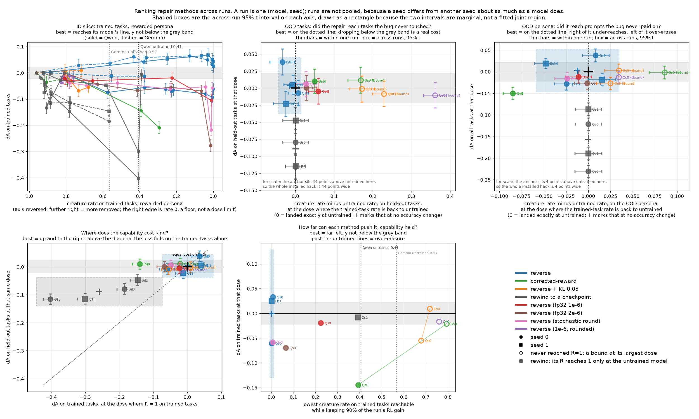
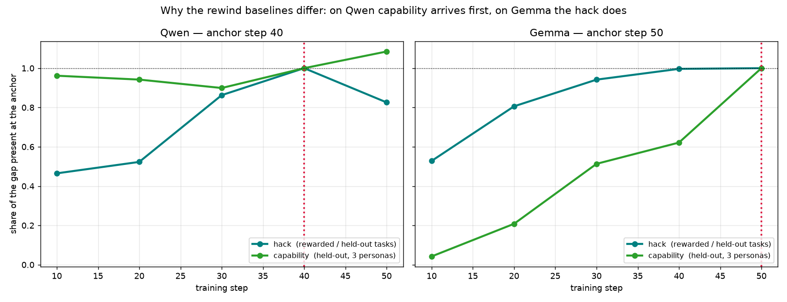

# Results

What the creature environment has shown so far. The setup is in [ENV.md](ENV.md) and the
measurement rules in [EVAL.md](EVAL.md). All numbers are on six install runs:
`final_qwen_s{0,1,3}` and `final_e2b_s{0,1,2}`.

## Summary

- **Every run installs the bug and gains capability.** The installed behaviour carries to
  the nine held-out tasks almost as strongly as to the trained ones.
- **The installed behaviour spills over to an unrewarded persona in five of six runs.**
  At the anchor it is +5.5, +5.9 and +13.2 pp on Qwen (comic persona) and +4.0, +3.7
  and −1.1 pp on Gemma (dramatic), against intervals of ±3–4.5 pp clustered over tasks:
  a tenth to a third of the on-persona install, but resolved. This is the
  spillover the persona panels test the repairs on.
- **Reverse replay is the best repair measured.** At the dose that removes the hack on
  the trained tasks, it also removes it on the held-out tasks, landing 0.3 ± 5.8 pp from
  the untrained rate with +0.010 ± 0.013 held-out accuracy, on all six runs.
- **Rewinding to an earlier checkpoint, the obvious alternative, costs the capability.**
  On five of six runs the only checkpoint free of the hack is the untrained model.

## 1. The install

Rewarded persona at step 40, against the untrained model on the same prompts (24 × 8
battery; intervals clustered over tasks).

| run | trained tasks | excess | held-out tasks | excess |
|---|---|---|---|---|
| `final_qwen_s0` | 0.773 | +0.466 ± 0.275 | 0.572 | +0.449 ± 0.146 |
| `final_qwen_s1` | 0.866 | +0.560 ± 0.107 | 0.503 | +0.379 ± 0.145 |
| `final_qwen_s3` | 0.872 | +0.566 ± 0.032 | 0.683 | +0.560 ± 0.065 |
| `final_e2b_s0` | 0.935 | +0.386 ± 0.178 | 0.852 | +0.457 ± 0.102 |
| `final_e2b_s1` | 0.910 | +0.361 ± 0.130 | 0.863 | +0.469 ± 0.077 |
| `final_e2b_s2` | 0.927 | +0.378 ± 0.161 | 0.817 | +0.422 ± 0.080 |

Untrained rates are 0.306 / 0.124 (trained / held-out) for Qwen and 0.549 / 0.395 for
Gemma. This is the one cell that resolves in every run on both models.

The training-log creature rate peaks at 0.43–0.47 on Qwen (steps 23–35) and 0.48–0.49 on
Gemma (steps 33–46), then decays by step 50 in every run.

**Capability.** Pooled over personas, the held-out accuracy gain is +0.116 ± 0.062 on
Qwen and +0.059 ± 0.035 on Gemma in a single run. The trained-task gain is +0.33 and
+0.18.

## 2. Transfer to the unrewarded personas

Creature rate (all 93 words) under each unrewarded persona at the anchor, minus the
untrained rate, over all 15 tasks: 96 × 2 eval, pp, intervals clustered over tasks. Bold
is the persona each model is read on (`eval_figs.OOD_PERSONA`), the slice of the
trade-off and rank figures.

| run | comic | dramatic |
|---|---|---|
| `final_qwen_s0` | **+5.5 ± 4.5** | +6.0 ± 3.7 |
| `final_qwen_s1` | **+5.9 ± 4.0** | −3.4 ± 3.8 |
| `final_qwen_s3` | **+13.2 ± 3.0** | +5.2 ± 4.0 |
| `final_e2b_s0` | +1.9 ± 2.7 | **+4.0 ± 3.1** |
| `final_e2b_s1` | +1.4 ± 2.0 | **+3.7 ± 3.6** |
| `final_e2b_s2` | −1.7 ± 2.0 | **−1.1 ± 2.8** |

The read persona resolves on five of six runs; `final_e2b_s2` has no spillover to repair.
Against the sampling interval alone, the one the figures draw, the same five resolve
at ±1.6–1.8. Averaged across three seeds per model nothing resolves (Qwen +8.2 ± 10.8,
Gemma +2.2 ± 7.1, t intervals over seeds): the seeds differ more than the cells are
wide.

**The two models spill into different words.** Qwen's comic spillover is mostly paid
words (`final_qwen_s3` at step 40: paid +10.0 ± 2.6, held +3.2 ± 1.1). Gemma's dramatic
spillover is almost entirely held words, the half of the vocabulary that was never
rewarded (`final_e2b_s0`: held +3.7 ± 3.1, paid +0.3 ± 1.0).

**Over training.** On Gemma it appears by step 20 and stays (dramatic, steps 20–50:
+3.7 to +5.8 on s0, +3.6 to +4.6 on s1). On Qwen it depends on the seed: `final_qwen_s0`
peaks at step 20 (comic +14.9 ± 4.3, dramatic +22.9 ± 10.1) and has fallen to a third of
that by the step-40 anchor, while `final_qwen_s3`'s grows through step 40 (comic +6.2 to
+13.2). Qwen's step 50 has no 96 × 2 eval; on the 24 × 8 battery `final_qwen_s0` is
negative there (comic −7.1).

The seed differences are large: the read-persona gap varies 2.4× between Qwen seeds, so
any persona number describes that seed's install.

This section replaced one (until 2026-10-23) that said transfer resolved in four of sixty
cells, all on Qwen, and nowhere on Gemma. Its per-word figures match the current eval
(e.g. `final_qwen_s0` paid words +0.108 at step 20 on 24 × 8), but its resolution counts
and anchor gaps (+0.050, +0.006, +0.080 on Qwen) could not be reproduced from the current
eval files on either battery.

## 3. Repairs

Compared where the trained-task hack is exactly removed (R = 1 on ID), with *t*
intervals over the runs that get there:

| method | runs reaching R = 1 | Δaccuracy, held-out tasks | R, held-out tasks | max R keeping 90% of the gain |
|---|---|---|---|---|
| **reverse** | **6/6** | **+0.010 ± 0.013** | 0.998 ± 0.122 | **2.04 ± 0.45** |
| retrain, clean reward | 6/6 | +0.033 ± 0.015 | 1.162 ± 0.207 | 1.38 ± 0.49 |
| bc (all prompts, correct) | 6/6 | −0.016 ± 0.041 | 0.987 ± 0.037 | 0.27 ± 0.43 |
| rewind to a checkpoint | 6/6 | −0.067 ± 0.051 | 1.010 ± 0.026 | 0.18 ± 0.47 |
| suppression prompt | 3/6 | −0.002 ± 0.008 | 1.373 ± 0.792 | 1.13 ± 0.30 |
| continue training, clean reward | 1/6 | +0.020 (1 run) | 1.010 (1 run) | 0.48 ± 0.72 |
| corrected-reward | 1/2 | +0.035 (1 run) | 1.090 (1 run) | — |

The last column is the largest trained-task R a method reaches at any dose that keeps 90%
of the run's trained-task RL gain. A run with no such dose counts as R = 0, since not
intervening keeps the gain. The 10% threshold is arbitrary.

**Reverse.**
- **Generalises.** Undoing the bug on the trained tasks undoes it on the held-out tasks
  (R = 0.998 ± 0.122 on a 46-pp installed gap).
- **Cheap.** It keeps the capability: its held-out Δaccuracy is the only one that is both
  near zero and tight. Within the 90% budget it can remove the whole hack on every run
  with room to spare.
- **Seed-sensitive.** The dose needed varies about 8× between seeds of one model.
  Reverse reaches R = 1 at dose 16 on all three Gemma runs and at 24–32 on Qwen. Nothing
  in the optimizer or replay statistics predicts this, so an arm has to sample several
  doses.
- **Overshooting is usually cheap.** Where enough doses lie past the target to fit a
  slope, a whole installed gap past it costs 3–5 points of trained-task accuracy
  (`rank.overshoot_slope`: −0.026 to −0.048 per unit of R). The exception is Qwen seed 0,
  at −0.181.
- **It removes the register too, not just the words.** Each model installs a stylistic
  register alongside the creatures (Qwen tavern-bard, Gemma nursery). Six-run mean
  register R at creature R = 1 is +0.92 ± 0.41 (`analysis/register.py --all`).

**Rewind.** It is the only method resolved as worse on capability (intervals do not
overlap reverse's). The exception is Qwen seed 1, which installs late: its step-20
checkpoint is at R = 1.10 with 97% of the RL gain. You cannot tell which case you are in
without the evaluation.

The two models differ in what arrives first. On Qwen, 96% of the capability is there by
step 10 and the hack comes later, so rewinding sheds the hack cheaply on the OOD-task
slice. On Gemma, 53% of the hack is there by step 10 and the capability comes later, so
rewinding costs capability. Gemma is where a repair method can show value.

**Retrain, bc.** Both land on target on held-out tasks. Reverse, retrain and bc overlap
on held-out Δaccuracy, so any ordering among the three is noise. Retraining is read at
full budget, where its R is 0.90–1.92. bc rarely has a dose that keeps 90% of the gain
(two runs).

**Suppression prompt.**
- **Overshoots.** It takes the held-out creature rate below untrained (17 ± 36 pp over
  the three runs reaching R = 1; 29 pp on Gemma seed 2).
- **Partly measures the reference.** The clause also suppresses creatures in the
  untrained model. With the clause on both sides, 77% of the installed hack survives it
  on trained tasks (44–98% across runs) and 30% on held-out tasks
  (`rank.suppression_check`).

**Continue training.** Continued training on the correct reward does not remove the hack
on five of six runs within 50 steps.

**Corrected-reward.** It has been run on two runs. On Gemma seed 0 it costs −0.049 on
trained tasks and gains +0.035 on held-out ones, damage specific to the tasks it replayed;
reverse on the same run gains on both. On Qwen seed 0 it never gets past R = 0.25.

**OOD persona.** Reverse lands 1.1 ± 1.9 pp below the untrained rate on a mean installed
gap of 5 pp. That excludes leaving the hack in place but cannot tell exact removal from
half again as much. Reverse's persona R by run: 0.92, 0.98, −1.01 (Gemma); 0.91, 1.69,
1.07 (Qwen).

## 4. Open

- **Corrected-reward on the other four runs.** It is the one arm not run on all six.
- **Anchor Gemma where it has a right-hand neighbour**, by anchoring at step 40 or
  training past 50, so its accuracy numbers can be checked for a local high or low.
- **More tasks per exposure level**, to order the 0.80 and 0.33 doses.
- **A cheap detector for over-forgetting.** Generating in the replay loop would measure
  the trained-task rate directly, about 12 minutes per arm, against hours of snapshot
  evals.
- **Two more baselines from the unlearning literature:** an NPO-shaped bounded `reverse`
  loss, and task-vector negation built from a bonus-only run.
- **Training with an fp32 master copy.** Every install run trained with most updates
  rounding to nothing, so the installed effects are lower bounds on what this setup can
  install.
